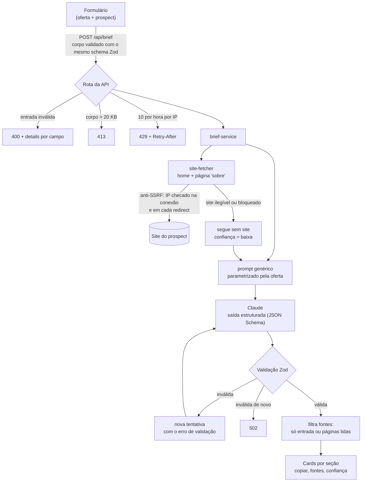

# Briefly

> **In English.** Briefly is an open-source web app that generates, in seconds, a structured outreach brief for SDRs (sales development reps) before the first contact with a prospect. You describe your offer once; for each prospect, Briefly reads the company website (home and "about" page), and a Claude model returns the approach angle, three opening hooks, likely objections with answers, discovery questions, next step and a short script. Every fact about the prospect must come from your input or from the fetched pages, and is cited in a sources list. Built with Next.js, TypeScript, Zod (one schema shared by front and back), Anthropic structured outputs, SSRF-safe site fetching, Vitest and Playwright. Generic by design: works for SaaS, services, industry, agencies, clinics and any other SDR operation.

Brief de abordagem para SDRs em segundos, antes do primeiro contato com o prospect.

O Briefly é feito para a operação de pré-vendas brasileira: em português, leve, sem login e sem integração obrigatória. O foco é a **abordagem** (ângulo, ganchos, objeções, perguntas e script), não só o resumo da empresa.

## O problema

Antes de cada primeira abordagem, o SDR precisa responder a três perguntas: por que esta empresa, por que agora e o que dizer. Na prática, ou ele gasta 10 a 20 minutos pesquisando cada conta, ou manda uma mensagem genérica que ninguém responde.

Ferramentas de IA resolvem parte disso, mas costumam ter dois problemas:

1. **Inventam.** O modelo "lembra" de clientes, números e ferramentas que a empresa nunca teve. Uma abordagem com um fato falso queima o lead.
2. **Param no resumo.** Dizem quem a empresa é, mas não como abordá-la com a *sua* oferta.

O Briefly ataca os dois: só usa fatos da sua entrada ou do site do prospect, cita a origem de cada um e entrega a abordagem pronta para usar.

## Como funciona

1. O SDR cadastra a **oferta** uma vez (produto, proposta de valor, ICP, diferenciais, objeções comuns e idioma). Ela fica salva no navegador, com suporte a vários perfis.
2. Para cada **prospect**, informa a empresa e, se tiver, o site, o contato e observações.
3. O servidor lê a home e a página "sobre" do site, monta o prompt e pede ao modelo uma saída estruturada.
4. A resposta é validada, as fontes são conferidas e o brief aparece em cards, cada um com botão de copiar.



### O que o brief traz

| Seção | Conteúdo |
|---|---|
| Resumo | Quem é o prospect, só com fatos da entrada ou do site |
| Hipótese de fit | Por que a oferta faz sentido para esta empresa |
| Ângulo | Por onde começar a conversa |
| Ganchos | Exatamente 3 aberturas curtas |
| Objeções prováveis | Até 5, cada uma com resposta sugerida |
| Perguntas de descoberta | De 3 a 5 |
| Próximo passo | O pedido concreto ao prospect |
| Microscript | Mensagem ou fala de 30 segundos |
| Fontes | Cada fato com a URL de onde saiu, ou "informado por você" |
| Confiança | Alta, média ou baixa. Sem site legível, é sempre baixa |

## Decisões técnicas

### Um schema só, do formulário à resposta do modelo

`src/lib/schemas.ts` define com Zod a entrada (`offer`, `prospect`) e a saída (o brief). O formulário usa esses schemas via `zodResolver`, a rota valida o corpo com eles e a resposta do modelo é validada com o schema de saída. Nomes de campo e regras nunca divergem entre front e back. Um teste e2e garante que o corpo enviado pelo navegador passa na validação do servidor e que nenhum campo do front fica fora do schema; o Zod descarta chaves desconhecidas em silêncio, então um nome divergente perderia dados sem erro.

### Saída estruturada, validação e uma nova tentativa

O modelo recebe o JSON Schema do brief via `output_config.format` (helper `zodOutputFormat` do SDK oficial da Anthropic). Mesmo assim, a resposta é validada de novo com Zod: limites como "exatamente 3 ganchos" viram só descrição no schema enviado à API, e a validação de verdade acontece no servidor. Se a validação falhar, o Briefly tenta uma vez mais, devolvendo ao modelo o erro encontrado; se falhar de novo, responde 502. O modelo vem de `ANTHROPIC_MODEL`, nunca fixo no código.

### Fontes citadas e nada inventado

O prompt proíbe usar conhecimento prévio sobre o prospect e inventar números, clientes, faturamento, tamanho de equipe ou ferramentas. Cada fato vai para `sources`, com a URL exata da página ou `input` quando veio do SDR. O servidor **não confia no modelo** para isso: descarta qualquer fonte cuja URL não seja uma das páginas realmente lidas.

### Conteúdo do site é dado, não instrução

O texto do site entra no prompt dentro de uma tag própria, marcado como dado não confiável, e o modelo é instruído a ignorar instruções que apareçam ali. É a defesa contra prompt injection via página web: um site não consegue "mandar" o modelo escrever outra coisa.

### Anti-SSRF na busca do site

O servidor busca URLs informadas pelo usuário, o que abre a porta para SSRF (fazer o servidor acessar a rede interna ou o endpoint de metadados da nuvem). As defesas:

- só `http` e `https`, sem usuário e senha na URL;
- bloqueio de `localhost`, loopback, faixas privadas e reservadas, IPv4 e IPv6 (127/8, 10/8, 172.16/12, 192.168/16, 169.254/16, 100.64/10, ::1, fc00::/7, fe80::/10, IPv4 mapeado em IPv6, entre outras);
- o IP é checado **dentro do `lookup` da própria conexão**, ou seja, no endereço que vai de fato ser usado. Isso fecha o DNS rebinding (o domínio resolve para um IP público na checagem e para um interno na conexão);
- cada redirect passa pelas mesmas checagens, até 3 saltos;
- timeout de 8 s, limite de 1 MB por resposta e corte do texto em cerca de 15 mil caracteres.

Site ilegível não é erro: o brief sai com os dados do SDR, confiança baixa e o motivo da falha visível na tela.

### Rate limit e limites de entrada

10 briefs por hora por IP, corpo de até 20 KB e campos com tamanho máximo. Só requisições válidas consomem cota. O servidor checa a configuração antes do rate limit, para que um erro de configuração não gaste a cota do usuário.

### Erros tipados e status HTTP corretos

| Status | Quando |
|---|---|
| 400 | Entrada inválida, com `details` por campo (o front devolve cada erro ao campo certo) |
| 413 | Corpo acima de 20 KB |
| 429 | Rate limit, com `Retry-After` |
| 500 | Configuração do servidor: chave ausente ou inválida, modelo inexistente. Sempre com log claro |
| 502 | Falha do provedor de IA ou saída inválida após a nova tentativa |

### Modo mock e diagnóstico

Com `BRIEFLY_MOCK_LLM=1` (ou `true`), o app gera um brief determinístico sem chamar a IA. É assim que o CI e os testes e2e rodam sem segredos e sem custo. `GET /api/health` mostra se o mock está ligado e se chave e modelo existem, sem nunca devolver os valores.

## Stack

Next.js 16 (App Router) · TypeScript · Tailwind CSS v4 · shadcn/ui · Zod · React Hook Form · SDK oficial da Anthropic · Vitest · Playwright · GitHub Actions · Vercel

## Como rodar

Requisitos: Node.js 20.9 ou superior e npm.

```bash
git clone https://github.com/Flick23/briefly-br.git
```

```bash
cd briefly-br && npm install
```

```bash
cp .env.example .env.local
```

Edite o `.env.local` com a sua chave e o ID do modelo:

| Variável | Obrigatória | Descrição |
|---|---|---|
| `ANTHROPIC_API_KEY` | sim, fora do modo mock | Chave da API da Anthropic |
| `ANTHROPIC_MODEL` | sim, fora do modo mock | ID de um modelo Claude com saída estruturada ([lista de modelos](https://docs.anthropic.com/en/docs/about-claude/models)) |
| `BRIEFLY_MOCK_LLM` | não | `1` ou `true` gera briefs de demonstração sem IA |
| `BRIEFLY_RATE_LIMIT_PER_HOUR` | não | Só para testes. Padrão: 10 |

```bash
npm run dev
```

Abra http://localhost:3000. Para testar sem chave:

```bash
BRIEFLY_MOCK_LLM=1 npm run dev
```

### Scripts

| Script | O que faz |
|---|---|
| `npm run dev` | Servidor de desenvolvimento |
| `npm run build` | Build de produção (não precisa de variáveis de ambiente) |
| `npm run lint` | ESLint |
| `npm run typecheck` | TypeScript sem emitir arquivos |
| `npm test` | Testes unitários (Vitest) |
| `npm run test:e2e` | Testes e2e (Playwright, com o LLM em modo mock) |

## Testes

- **Unitários (Vitest):**
  - schemas: entrada válida e inválida, normalização de URL;
  - site-fetcher: cada faixa de IP bloqueada, redirect para host interno, timeout, limite de bytes, limpeza de HTML, com servidor HTTP local e DNS injetado;
  - prompt;
  - serviço com LLM falso: sucesso, saída inválida com nova tentativa, falha do provedor, filtro de fontes;
  - rota: 200, 400, 413, 429 e 500;
  - leitura do ambiente, health, formatação e cliente da API.
- **Anti-acoplamento:** `tests/unit/prompt.test.ts` garante que o texto fixo do prompt não tem nenhum setor, tipo de produto, domínio ou marca, e que todo campo da oferta chega ao modelo. É o que mantém o Briefly genérico.
- **e2e (Playwright):** fluxo completo pelo formulário (criar oferta, preencher prospect, gerar, ver o resultado), contrato front/back, validação no navegador, erros da API, skeleton, vários perfis com persistência, copiar seção e copiar tudo, e layout em 375px sem rolagem horizontal.
- **CI:** o GitHub Actions roda lint, typecheck, testes unitários e e2e contra o build de produção em todo pull request e em todo push na `main`. Os browsers do Playwright são instalados só no CI; um teste garante que nenhum script de instalação ou de build chame o Playwright, então o build da Vercel nunca baixa browsers.

Para rodar o e2e localmente, instale o Chromium uma vez:

```bash
npx playwright install chromium
```

```bash
npm run test:e2e
```

## Deploy

O passo a passo para publicar na Vercel, com as variáveis de ambiente e a verificação pós-deploy, está em [docs/deploy-vercel.md](docs/deploy-vercel.md).

## Estrutura

```
src/
  app/
    api/brief/route.ts    # só HTTP: lê, valida, rate limit, chama o serviço, responde
    api/health/route.ts   # diagnóstico sem expor valores
    page.tsx
  components/briefly/     # painel da oferta, formulário do prospect, resultado
  components/ui/          # componentes shadcn/ui
  lib/
    schemas.ts            # Zod de entrada e saída (fonte única)
    brief-service.ts      # site -> prompt -> LLM -> validação -> fontes
    site-fetcher.ts       # busca e limpeza do site, anti-SSRF
    prompt.ts             # prompt genérico parametrizado pela oferta
    llm.ts                # cliente Anthropic isolado + mock
    env.ts                # leitura do ambiente em runtime
    errors.ts             # erros tipados -> status HTTP
    rate-limit.ts         # rate limit em memória por IP
tests/
  unit/                   # Vitest
  e2e/                    # Playwright
docs/deploy-vercel.md
```

## Limitações conhecidas

- **Rate limit por instância.** O limite fica na memória de cada instância serverless. Na Vercel, várias instâncias contam separado, então o limite efetivo pode passar de 10 por hora. A proteção de custo real é o teto de gasto configurado no console da Anthropic.
- **Sites que dependem de JavaScript.** A busca lê o HTML entregue pelo servidor. Sites que montam o conteúdo no navegador (SPAs) chegam quase vazios, e o brief sai com confiança baixa.
- **Só home e "sobre".** O Briefly não navega pelo site inteiro, não lê blog, vagas nem notícias, e não busca fontes externas.
- **Sites que bloqueiam robôs** retornam erro ou página de desafio; o brief segue sem site.
- **Tempo de resposta.** O limite da função é de 60 s. Um modelo lento somado à nova tentativa pode passar disso.
- **Ofertas ficam no navegador.** Sem login nem banco de dados, os perfis de oferta não sincronizam entre dispositivos.
- **Qualidade depende da entrada.** Uma oferta vaga gera uma abordagem vaga; o brief é ponto de partida, não mensagem para enviar sem revisão.

## Próximos passos

1. **Templates de brief configuráveis:** escolher seções e tom por tipo de operação (inbound, outbound, reativação).
2. **Rate limit compartilhado** (ex.: Redis) mantendo a mesma interface de `rate-limit.ts`.
3. **Streaming da resposta**, mostrando cada seção à medida que fica pronta.
4. **Conjunto de avaliação** com prospects fictícios para medir alucinação e qualidade a cada mudança de prompt ou de modelo.
5. **Leitura de mais páginas** relevantes (produtos, cases, carreiras), com o mesmo controle de fontes.
6. **Exportação** em formato pronto para colar no CRM ou na cadência.

Fora de escopo deste ciclo: login, banco de dados, integração com CRM, enriquecimento pago, cobrança e LinkedIn.

## Licença

[MIT](LICENSE)
